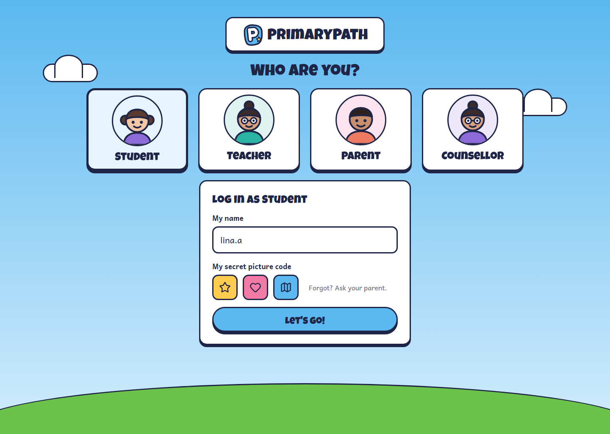
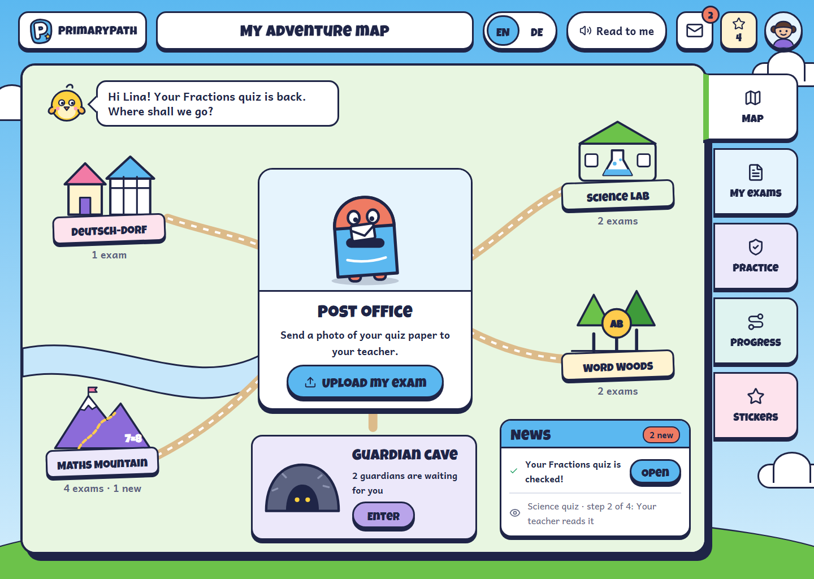
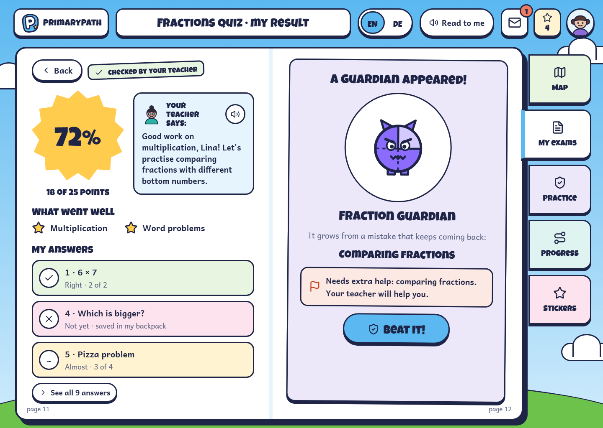
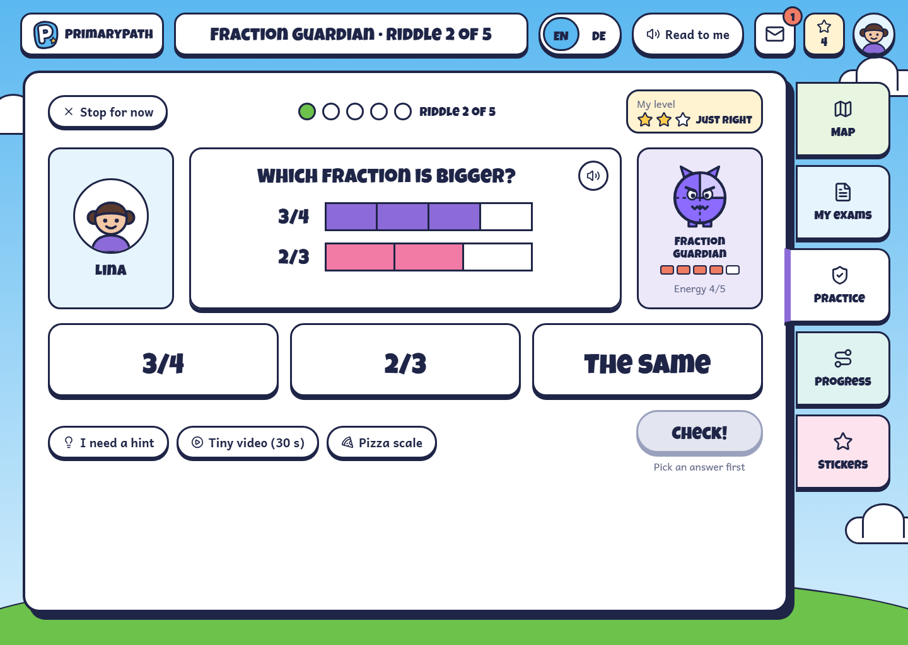
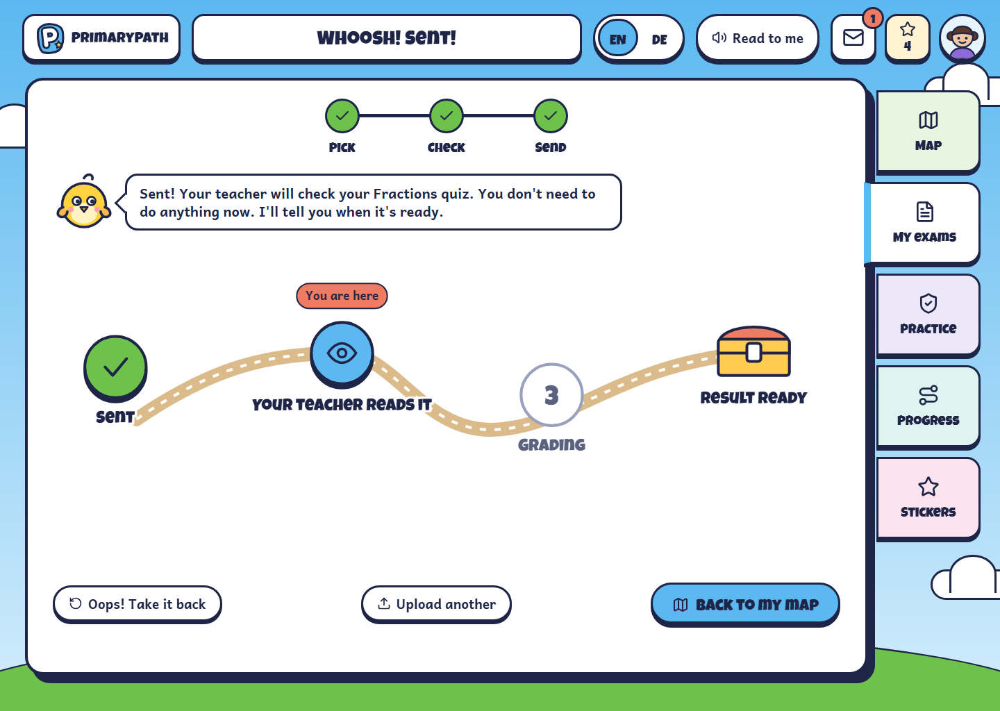
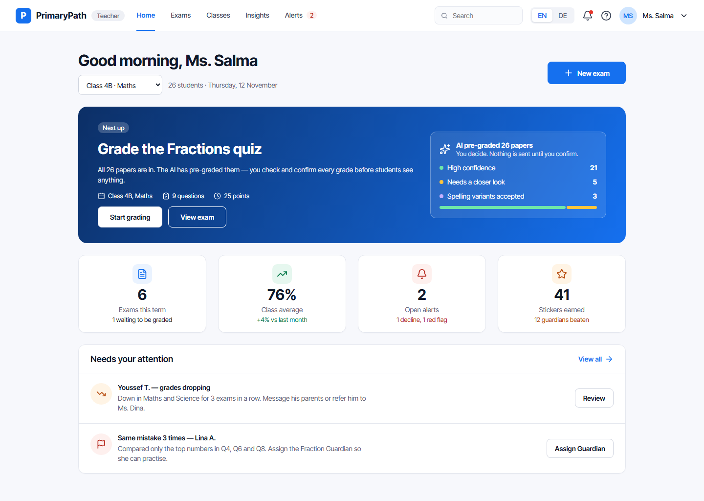
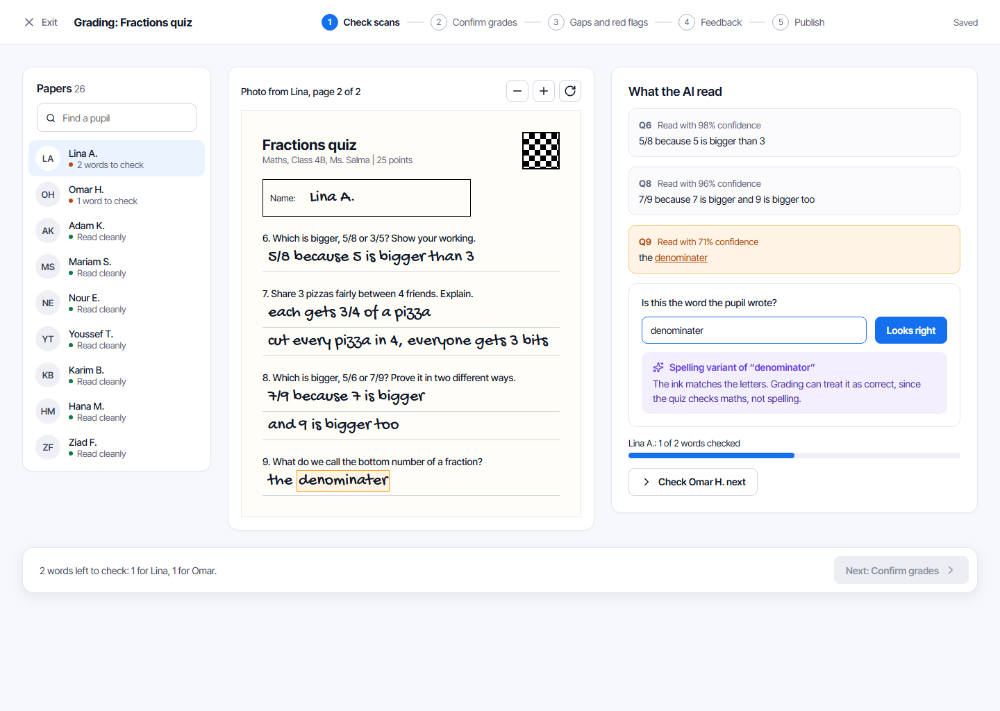
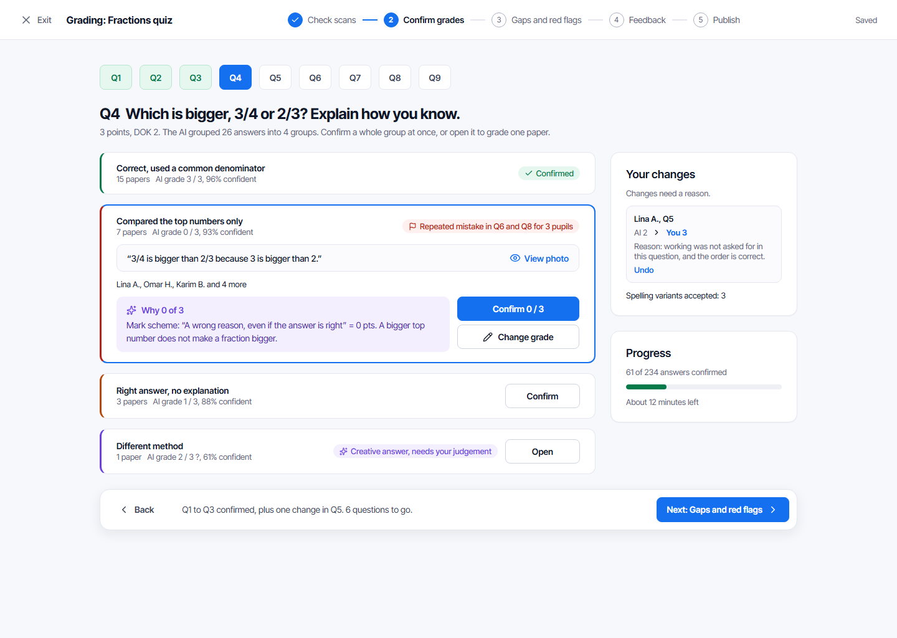
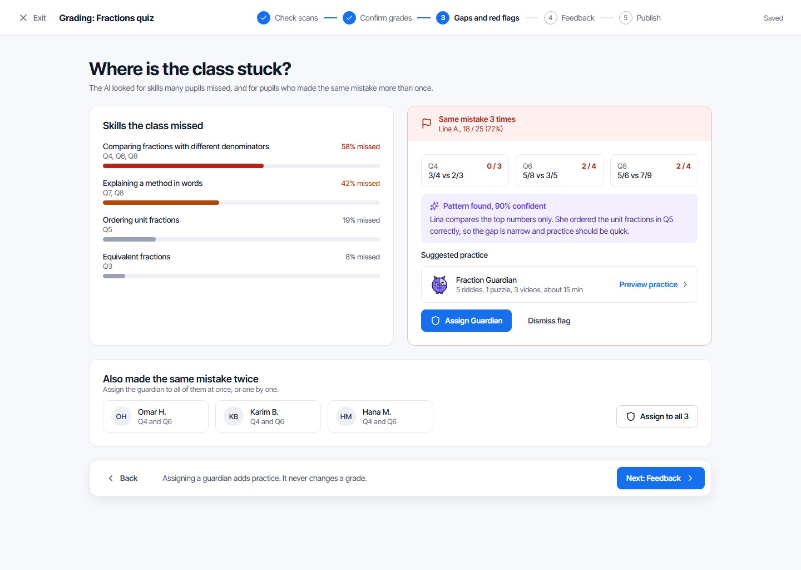
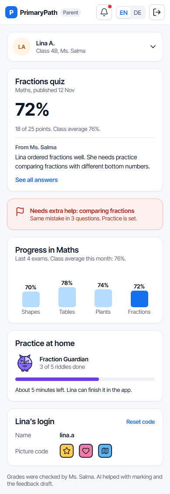

# PrimaryPath

AI-assisted exam grading and learning-gap practice for children in Grades 1 to 5. This is the coded front-end of our CSEN 909 Human Computer Interaction project (Winter 2026, German University in Cairo).

**Team:** Abdelrahman Anbar (leader), Abdelrahman Youssef, Mohammed Wahba Ali, Shahd Alaa

## Motivation

Existing AI grading tools read handwriting and suggest grades well, but the process stops at the grade, and none of it is designed for children. A weak point is detected, but nothing turns it into an activity the child completes, so the teacher never sees whether it was fixed. Our review also found that grading tools don't warn anyone when a child's grades keep dropping across subjects, and they leave parents out.

PrimaryPath addresses this in three ways:

- **Guardians:** each weak point the teacher confirms becomes a story character, such as the Fraction Guardian. The child beats it with short riddles, a puzzle and tiny videos, and the sticker reward only comes from fixing a real weak point.
- **Teacher in control:** the AI only suggests. Nothing reaches a child until the teacher has checked and confirmed it.
- **Early warning and parents:** decline alerts, counsellor referrals and a parent view keep the right adults informed.

## Build Status

The app builds, and all 12 browser tests pass. It is a prototype, and all AI output is simulated with hard-coded data.

Known issues:

- **Roles aren't connected:** publishing as the teacher doesn't change what the student sees, and logging in resets the demo data. Each role has to be demonstrated separately.
- **Partial grading:** only Q4 has full answer groups. The other questions show a short note.
- **Publish checks are fixed text:** "All 234 answers confirmed" appears even if questions were skipped, and Next is never blocked on the grades step.
- **Only one playable riddle:** "Next riddle" goes straight to the win screen.
- **Not everything opens:** in the student view, only the Fractions quiz card and Maths Mountain lead anywhere. Other exam cards and map places do nothing.
- **Search boxes do nothing:** the teacher and counsellor header searches accept typing but return no results.
- **Demo data is limited:** only Class 4B has data, and the other class tabs show a message.
- **German is partial:** student pages are translated. Teacher pages translate the navigation, feedback drafts and parent messages only. Most German text was not reviewed by a native speaker.
- **"Mark as resolved" has no undo:** it removes the alert immediately.
- **Not included from the design:** the Matching puzzle overlay, which no screen links to, and the separate phone camera screen.
- **Build warning:** Vite warns that the main JavaScript file is over 500 kB.
- **Lint warnings:** oxlint reports warnings, including about shared-file exports and the upload page's in-memory store. They don't stop the app from running.

## Code Style

- **Language:** TypeScript with strict type checking, and React function components with hooks.
- **Naming:**
  - `PascalCase` for components and types (`PizzaScale`, `GradeChange`)
  - `camelCase` for functions, variables and props (`useApp`, `fitCanvas`)
  - `UPPER_CASE` for fixed data (`ROLES`, `QUESTIONS`)
  - short lowercase class names in CSS (`.kbtn`, `.tbtn`)
- **Formatting:** 2-space indents, single quotes and no semicolons. See [.editorconfig](.editorconfig).
- **Colours:** defined once as CSS variables in [src/styles/base.css](src/styles/base.css).
- **Linting:** [oxlint](https://oxc.rs), run with `npm run lint`.

## Screenshots

| | |
|---|---|
|  Login and role picker |  Student adventure map |
|  Student result and guardian |  Guardian riddle |
|  Paper sent, with status trail |  Teacher home |
|  Teacher checks the OCR text |  Teacher confirms or overrides grades |
|  Learning gaps and red flags |  Parent view on a phone |

## Tech/Framework Used

| Technology | Used for |
|---|---|
| [React](https://react.dev) | Interface components |
| [TypeScript](https://www.typescriptlang.org) | Type checking |
| [Vite](https://vite.dev) | Development server and build |
| [React Router](https://reactrouter.com) | Page navigation |
| [Lucide](https://lucide.dev) | Icons |
| Plain CSS | Styling and responsive layout |
| Web Speech API | Read-aloud, built into the browser |
| [Playwright](https://playwright.dev) | Browser tests |

The project is front-end only, and demo progress is saved in the browser's local storage.

## Features

**Student**
- Story map home with places, news and a guide character, Pip
- Upload by photo or file, with drag and drop, page checks, a blurry-photo warning and a pre-send checklist
- Status trail from Sent to Result ready
- Result page with grade, teacher feedback, answers, weak point and red flag
- Mailbox of notifications from the teacher
- Guardian riddles with hints, a tiny video and the Pizza Scale puzzle
- Backpack of missed questions with subject and topic filters
- Progress trail and list of weak points
- Sticker album and profile customisation
- Read to me and English/German switching

**Teacher**
- Dashboard with next task, summary cards and items needing attention
- Five-step grading: check scans, confirm grades, gaps and red flags, feedback, publish
- OCR checking with confidence levels and spelling variants
- Confirm grades by answer group, or override them with a required reason
- Assign guardians or dismiss red flags, with undo
- Editable AI feedback with tone, language and a live pupil preview
- Publish confirmation with a 10-second undo
- Five-step exam creation by import or AI prompt, with mark schemes, DOK balance and a reward sticker
- Class roster, pupil profiles and notes
- Insights on missed questions, DOK levels and guardian results
- Alerts with parent messages, counsellor referrals and adjustable rules

**Parent**
- Phone layout with child switcher, grades, feedback, red flags, progress and practice

**Counsellor**
- Referral inbox showing the teacher's note and limited shared data

## Code Examples

**1. Shared state hook** ([src/state.tsx](src/state.tsx))

```tsx
export function useApp() {
  const ctx = useContext(AppContext)
  if (!ctx) throw new Error('useApp must be used inside AppProvider')
  return ctx
}
```

**2. Reading text aloud** ([src/state.tsx](src/state.tsx))

```tsx
export function speak(text: string, lang: Lang, onEnd?: () => void) {
  if (!('speechSynthesis' in window)) {
    onEnd?.()
    return
  }
  window.speechSynthesis.cancel()
  const u = new SpeechSynthesisUtterance(text)
  u.lang = lang === 'de' ? 'de-DE' : 'en-GB'
  u.rate = 0.9
  u.onend = () => onEnd?.()
  u.onerror = () => onEnd?.()
  window.speechSynthesis.speak(u)
}
```

**3. Fitting the login page to the window** ([src/main.tsx](src/main.tsx))

```tsx
function fitCanvas() {
  const { innerWidth: w, innerHeight: h } = window
  const z = w <= 1240 ? 1 : Math.max(0.62, Math.min(1, w / 1440, h / 1024))
  document.documentElement.style.setProperty('--z', String(z))
}
```

**4. Taking uploaded files** ([src/student/Upload.tsx](src/student/Upload.tsx))

```tsx
const takeFiles = (files: FileList | null) => {
  if (!files || files.length === 0) return
  pagesStore = Array.from(files).map((f) => ({ id: nextId++, url: f.type.startsWith('image/') ? URL.createObjectURL(f) : undefined }))
  nav('/s/check')
}
```

**5. Drawing a pizza slice** ([src/student/PizzaScale.tsx](src/student/PizzaScale.tsx))

```tsx
const slice = (i: number) => {
  const a0 = (i / cuts) * 2 * Math.PI - Math.PI / 2
  const a1 = ((i + 1) / cuts) * 2 * Math.PI - Math.PI / 2
  const large = a1 - a0 > Math.PI ? 1 : 0
  return `M50 50L${50 + r * Math.cos(a0)} ${50 + r * Math.sin(a0)}A${r} ${r} 0 ${large} 1 ${50 + r * Math.cos(a1)} ${50 + r * Math.sin(a1)}Z`
}
```

## Installation

**You need:**
- [Node.js](https://nodejs.org) 20.19 or newer in the 20 line, or 22.12 or newer. npm comes with it.
- A modern browser such as Chrome, Edge or Firefox.
- An internet connection for the install step and the web fonts.

The full list is in [requirements.txt](requirements.txt).

**Steps:**

```bash
git clone https://github.com/abdelrahmananbar/PrimaryPath.git
cd PrimaryPath
npm install
npm run dev
```

Open the address it prints, usually http://localhost:5173. Press `Ctrl + C` in the terminal to stop.

**On Windows:**

| Error | Fix |
|---|---|
| `npm is not recognized` | Install Node.js, then close and reopen your terminal and editor. |
| `running scripts is disabled on this system` | Use `npm.cmd install` and `npm.cmd run dev` instead. |

**Commands:**

| Command | What it does |
|---|---|
| `npm install` | Installs the packages |
| `npm run dev` | Runs the app for development |
| `npm run build` | Checks the types and builds the site into `dist/` |
| `npm run preview` | Serves the built site locally |
| `npm run lint` | Checks the code for common problems |
| `npm test` | Runs the browser tests |

**Deploying:** `npm run build` creates a static site in `dist/`, which can be hosted on Vercel or GitHub Pages. Paths are relative and routes use `#`, so it works from a sub-folder.

**Trying it out:** pick a role on the login screen and log in. No real password is needed. On the riddle, the right answer is 3/4.

## API References

There is no server or external API. These are the app's main page routes:

| Route | Page |
|---|---|
| `/#/` | Login and role picker |
| `/#/s/map` | Student map |
| `/#/s/upload` | Student upload |
| `/#/s/result` | Student result |
| `/#/s/riddle` | Guardian riddle |
| `/#/s/cave` | Guardian cave and backpack |
| `/#/t` | Teacher home |
| `/#/t/grade/:step` | Grading: `scans`, `grades`, `gaps`, `feedback`, `publish` |
| `/#/t/new/:step` | New exam: `choose`, `ai`, `questions`, `dok`, `sticker`, `confirm` |
| `/#/t/classes` | Class roster |
| `/#/t/insights` | Insights |
| `/#/t/alerts` | Alerts |
| `/#/parent` | Parent view |
| `/#/counsellor` | Counsellor inbox |

## Tests

There are 12 Playwright tests in [tests/workflow.spec.ts](tests/workflow.spec.ts). They click through the built app in a real browser.

The first time, install the test browser:

```bash
npx playwright install chromium
```

Then run:

```bash
npm test
```

| # | What it checks |
|---|---|
| 1 | Login shows every role and fits one laptop screen |
| 2 | Each role logs in to its own home page |
| 3 | A blurry paper can't be sent until it's retaken and the checklist is ticked |
| 4 | Opening a result clears its mailbox notification |
| 5 | The language switch changes the student page to German |
| 6 | The riddle gives feedback, and beating it earns a sticker |
| 7 | The teacher must check low-confidence OCR text before grading |
| 8 | Overriding an AI grade requires a reason |
| 9 | A red flag can be dismissed and restored, or assigned |
| 10 | Edited feedback updates the pupil preview |
| 11 | Publishing asks for confirmation and offers undo |
| 12 | A parent can switch children on a phone without sideways scrolling |

Example of test 8:

```ts
test('overriding an AI grade requires a reason', async ({ page }) => {
  await page.goto('/#/t/grade/grades')
  await button(page, 'Change grade').click()
  await dialogButton(page, '2').click()
  const save = dialogButton(page, 'Save change')
  await expect(save).toBeDisabled()
  await page.getByPlaceholder('Why are you changing it?').fill('Partly right reasoning.')
  await save.click()
  await expect(page.getByText('Q4 group, 7 papers')).toBeVisible()
})
```

## Contribute

The project has known gaps, listed under Build Status, and those are good places to start.

1. Fork the repository and create a branch, for example `fix-exam-cards`.
2. Make your change, following the Code Style section.
3. Run `npm run lint` and `npm test`.
4. Open a pull request describing what changed, with a screenshot for visual changes.

Useful next steps are making the other exam cards open, adding the remaining riddles, connecting the roles, completing the German text, and having a native speaker review it.

## Credits

- **Design:** the team's hi-fi prototype, built in [Penpot](https://penpot.app).
- **Research:** the sources cited in our Milestone 1 proposal, including GradeLab, Grade Direct, Colling et al. (2024) and Dülger et al. (2025).
- **AI assistance:** [Claude Code](https://claude.com/claude-code) helped write the code, tests and this README from our prototype. The chat history is submitted with the project, as the brief requires.
- **Fonts:** [Google Fonts](https://fonts.google.com).
- **Documentation:** [React](https://react.dev), [Vite](https://vite.dev), [React Router](https://reactrouter.com), [Playwright](https://playwright.dev) and [MDN Web Docs](https://developer.mozilla.org).

## License

This is university coursework, and the team has not chosen an open-source license for its own code. All rights are reserved by the team unless stated otherwise.

Third-party software and fonts keep their own licenses:

| Package | License |
|---|---|
| React, React DOM, React Router | MIT |
| Vite, @vitejs/plugin-react, oxlint | MIT |
| Lucide | ISC |
| TypeScript, Playwright | Apache 2.0 |
| Andika, Inter Tight, Gochi Hand | SIL Open Font License |
| Luckiest Guy | Apache 2.0 |
